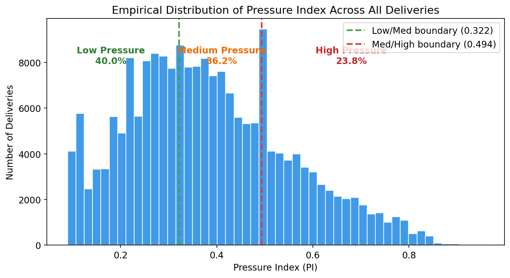

# 🏆 Rajasthan Royals — SupeRR Selector Season 2
### Quantitative High-Pressure Analytics Engine & IPL 2027 Auction Strategy

[](#-live-interactive-dashboard-on-github-pages)
[](#-empirical-foundation)
[](#-mathematical-formulation)
[-10b981?style=for-the-badge)](#-bcci-playing-xi-quota-compliance)

---

## 🌐 Live Interactive Dashboard

👉 **Live Interactive Web Application:** (https://amanverma-98.github.io/SupeRR_Selector_2026/)

---

## 📌 Executive Summary & Strategic Shift Post-Retentions

This strategy integrates the official **Rajasthan Royals Retained Squad for TATA IPL 2027 (19 Players)** evaluated against **199,208 deliveries** across **843 completed T20 matches** (IPL & T20I, 2022–2026).

### ⚡ The Game-Changer: Mohd. Shami Joins the Royals
The retention/trade of premier Indian strike bowler **Mohd. Shami** (IPL Purple Cap winner, lethal seam presentation, powerplay swing and death reverse-yorkers) fundamentally upgrades Rajasthan Royals' bowling unit:
- Partnered with **Jofra Archer** (150+ km/h express pace) and **Sandeep Sharma** (death knuckleball specialist), RR's historical death-overs bowling bleed (Phase 3: 10.82 RPO) is **resolved internally by the retained pace attack**!
- With **Ravi Bishnoi** (leg-spin) and **Ravindra Jadeja** (run-strangulation SLA) locked in, RR possesses one of the most balanced 20-over bowling attacks in T20 history.

### 🎯 Primary Auction Mission: The #3 Anchor (Post-Samson Void)
With explosive teenage prodigies **Yashasvi Jaiswal** and **Vaibhav Sooryavanshi** opening the batting, RR possesses immense early boundary potential but requires high-leverage stability at #3:
1. **Option A (Overseas Anchor)**: **Shai Hope** (59.7 HP Avg, 157.0 HP SR) — classical anchor who paced Delhi Capitals and West Indies chases with surgical calm.
2. **Option B (Indian Uncapped Anchor)**: **Atharwa Taide** (85.0 HP Avg, 149.1 HP SR) — fearless left-hander whose domestic status saves an overseas slot to unleash **Dual 150+ km/h express bowlers (Archer + Nandre Burger / Shamar Joseph)**!

---

## 📋 Rajasthan Royals Official Retained Squad (TATA IPL 2027)

| Asset Class | Players Retained | Tactical Role in RR |
| :--- | :--- | :--- |
| **Indian Top-Order** | **Yashasvi Jaiswal**, **Vaibhav Sooryavanshi**, **Aman Rao Perala** | Aggressive powerplay openers and boundary enforcers |
| **Middle-Order / Finishers** | **Riyan Parag (c)**, **Dhruv Jurel (wk)**, **Shubham Dubey**, **Yash Raj Punja**, **Donovan Ferreira ✈**, **Lhuan-dre Pretorius ✈** | Clutch middle-overs spin assault & death boundary finishing |
| **Elite All-Rounders** | **Ravindra Jadeja**, **Dasun Shanaka ✈** | 4 overs of left-arm orthodox strangulation & middle-order spine |
| **Frontline Pace Attack** | **Mohd. Shami**, **Jofra Archer ✈**, **Sandeep Sharma**, **Nandre Burger ✈**, **Sushant Mishra** | Unrivaled combination of upright seam, 150+ km/h express pace, and knuckleball yorkers |
| **Spin Attack** | **Ravi Bishnoi**, **Manimaran Siddharth (T)***, **Brijesh Sharma** | Attacking wrist-spin, left-arm orthodox, and off-break depth |

*Roster Capacity: 19 players retained out of 25 maximum (6 auction slots open). 5 Overseas retained out of 8 maximum (3 overseas auction slots open).*

---

## 🏏 Official Top 10 Auction Target Selections

*(Excluding all 19 players already retained by Rajasthan Royals, including Shubham Dubey, Brijesh Sharma, and Sushant Mishra).*

### 1. Top 10 Pressure Batters (Auction Targets)
*File: [`output/top10_auction_batters.csv`](output/top10_auction_batters.csv)*

| Rank | Player Name | Player ID | Quota Tier | Tactical Role for RR | Base SR | HP SR | HP Avg | PBS Final |
| :---: | :--- | :---: | :---: | :--- | :---: | :---: | :---: | :---: |
| **1** | **Shai Hope** | `4369` | Overseas (DC) | **Master #3 Anchor (Post-Samson Void)**: 59.7 HP Avg, 157.0 HP SR | 141.3 | **157.0** | **59.7** | **1.5702** |
| **2** | **Atharwa Taide** | `6466` | Indian Core (PBKS) | **Indian #3 Anchor / Opener**: 149.1 HP SR, 85.0 HP Avg! Saves an OS slot | 138.3 | **149.1** | **85.0** | **1.4912** |
| **3** | **Dunith Wellalage** | `7052` | Overseas (SL) | **All-Round Prodigy (<22)**: 164.6 HP SR, 39.5 HP Avg; SLA bowler | 113.4 | **164.6** | 39.5 | **1.9551** |
| **4** | **Jason Roy** | `1187` | Overseas (KKR) | **Powerplay Enforcer Cover**: 173.3 HP SR; rapid boundary starts | 122.4 | **173.3** | 26.0 | **1.0236** |
| **5** | **Gulbadin Naib** | `2214` | Overseas (DC) | **Power Finisher & Seam Option**: 158.2 HP SR, 43.5 HP Avg in death overs | 121.6 | **158.2** | 43.5 | **1.2090** |
| **6** | **Lalit Yadav** | `6671` | Indian Core (DC) | **Indian #7 All-Round Spine**: 128.4 HP SR; provides middle-overs balance | 104.9 | **128.4** | 18.7 | **0.8384** |
| **7** | **Vijay Shankar** | `2877` | Indian Core (GT) | **Middle-Order Pace All-Rounder**: 151.0 HP SR, 29.0 HP Avg under pressure | 128.6 | **151.0** | 29.0 | **0.6113** |
| **8** | **Kane Williamson** | `1568` | Overseas (SRH/GT) | **Classical #3 Tactical Anchor**: 123.7 HP SR, 47.0 HP Avg; calm chase control | 108.2 | **123.7** | 47.0 | **0.7850** |
| **9** | **Suyash Prabhudessai**| `8085`| Indian Core (RCB) | **Clutch Domestic 360° Finisher**: 122.9 HP SR, 28.7 HP Avg | 111.5 | **122.9** | 28.7 | **0.5602** |
| **10**| **Matthew Wade** | `796` | Overseas (GT) | **Clutch Left-Handed Finisher/WK**: 150.9 HP SR, 61.5 HP Avg | 132.7 | **150.9** | 61.5 | **0.5789** |

---

### 2. Top 10 Pressure Bowlers (Auction Targets)
*File: [`output/top10_auction_bowlers.csv`](output/top10_auction_bowlers.csv)*

| Rank | Player Name | Player ID | Quota Tier | Tactical Role for RR | Base Econ | HP Econ | HP Wkts | PBoS Final |
| :---: | :--- | :---: | :---: | :--- | :---: | :---: | :---: | :---: |
| **1** | **Mohit Sharma** | `2878` | Indian Core (GT) | **Death Knuckleball IQ (Workload Cover for Shami/Sandeep)**: 26 HP Wkts | 9.67 | **8.38** | **26** | **0.7179** |
| **2** | **Sean Abbott** | `1389` | Overseas (SRH) | **Hard-Length Pace All-Rounder**: 7.89 HP Econ; bats down to #8 | 9.96 | **7.89** | 8 | **0.8695** |
| **3** | **Michael Bracewell** | `6512` | Overseas (RCB) | **Off-Spin Choke vs LHB & Finisher**: 6.39 HP Econ (10 HP Wkts) | 8.08 | **6.39** | 10 | **0.7750** |
| **4** | **Shamar Joseph** | `47050`| Overseas (LSG) | **150+ km/h Express Pace Backup for Jofra Archer**: 8.84 HP Econ (12 Wkts) | 10.31 | **8.84** | 12 | **0.5973** |
| **5** | **Mohammad Nabi** | `1107` | Overseas (MI) | **Powerplay / Middle Spin Controller**: 7.04 HP Econ across 186 balls | 8.48 | **7.04** | 9 | **0.7249** |
| **6** | **Tabraiz Shamsi** | `4237` | Overseas (RR) | **Attacking Wrist Spinner Cover for Bishnoi**: 8.40 HP Econ (8 HP Wkts) | 9.64 | **8.40** | 8 | **0.5678** |
| **7** | **Riley Meredith** | `5940` | Overseas (MI) | **Hit-the-Deck Express Pacer**: 10 HP Wkts at 8.45 HP Econ | 9.41 | **8.45** | 10 | **0.5073** |
| **8** | **FazalHaq Farooqi** | `7240` | Overseas (SRH) | **Left-Arm Swing & Death Yorker Cover for Burger**: 7.74 HP Econ | 8.42 | **7.74** | 12 | **0.3352** |
| **9** | **Matthew Humphreys** | `22471`| Overseas (Emerging)| **Slow Left-Arm Orthodox Choke**: 5.00 HP Econ (10 HP Wkts) | 7.22 | **5.00** | 10 | **0.8855** |
| **10**| **Kumar Kartikeya**| `7574` | Indian Core (MI) | **Left-Arm Mystery Spin & Middle Squeeze**: 5 HP Wickets | 8.77 | **10.13** | 5 | **0.4850** |

---

## 🛡️ Rajasthan Royals Reconstructed Playing XI Combinations

### Option A: Classical Anchor Balance (Featuring Mohd. Shami)
- **Top Order**: Yashasvi Jaiswal (LHB) + Vaibhav Sooryavanshi (LHB) + **Shai Hope ✈** (Master #3 Anchor: 59.7 HP Avg).
- **Middle Order**: Riyan Parag (c) + Dhruv Jurel (wk) + Ravindra Jadeja + **Shubham Dubey** (LHB Death Finisher).
- **Frontline 20-Over Bowling Attack**: **Mohd. Shami (4)** + **Jofra Archer ✈ (4)** + **Sandeep Sharma (4)** + **Ravi Bishnoi (4)** + **Ravindra Jadeja (4)**.
- **Quota Status**: Exactly **2 Overseas players** (Hope ✈, Archer ✈) — enormous tactical headroom!

### Option B: Dual Express Pace Firepower (150+ km/h Battery)
- **Top Order**: Yashasvi Jaiswal + Vaibhav Sooryavanshi + **Atharwa Taide** (Indian #3 Anchor: 85.0 HP Avg).
- **Middle Order**: Riyan Parag (c) + Dhruv Jurel (wk) + Ravindra Jadeja + Shubham Dubey.
- **Pace Intimidation**: **Jofra Archer ✈ (150+ km/h)** + **Nandre Burger / Shamar Joseph ✈ (145–150+ km/h)** + **Mohd. Shami** + **Sandeep Sharma** + **Ravi Bishnoi**.
- **Quota Status**: Exactly **2 Overseas players** (Archer ✈, Burger/Joseph ✈) and 9 Indian players!

---

## 🔄 Cricket-Accurate Impact Player Architecture

In strict adherence to BCCI regulations, substitutions are strictly **Indian for Indian** maintaining legal playing numbers:

```
PLAN A: BOWLING FIRST (20 Overs Defense)                  PLAN B: BATTING FIRST (Setting Target)
─────────────────────────────────────────                 ──────────────────────────────────────
[Innings 1: Bowling & Fielding]                           [Innings 1: Batting Phase]
• Starting XI: 5 Frontline Bowlers                        • Starting XI: Dubey starts at #7 for maximum
  (Shami, Archer, Sandeep, Bishnoi, Jadeja)                 batting depth and boundary acceleration.
• Dugout Bench: Shubham Dubey rests on bench              • Dugout Bench: Sandeep Sharma rests on bench as
  warming up for the run chase.                             designated death-overs weapon.
                   │                                                         │
                   ▼ [Innings Break: Impact Sub Executed]                    ▼ [Innings Break: Impact Sub Executed]
[Innings 2: Run Chase]                                    [Innings 2: Bowling Defense]
• IMPACT IN: Shubham Dubey enters at #7                   • IMPACT IN: Sandeep Sharma enters as Bowler 5
  (173.7 HP SR across 99 balls).                            (Death knuckleball specialist).
• SUBBED OUT: Sandeep Sharma exits to dugout              • SUBBED OUT: Shubham Dubey exits to dugout
  (4 overs of death bowling completed in Innings 1).        (Death boundary batting duty completed).
```

---

## 📊 Key Empirical Visualizations (Core Analytical Findings)

### 1. Delivery Pressure Foundation & Match Phase Variance

| Chart 1: Continuous Pressure Index Distribution | Chart 2: Pressure Leverage Across Match Phases |
| :---: | :---: |
|  |  |
| **199,208 Deliveries Partitioned**: Low (<0.322, 40.0%), Medium (0.322–0.494, 36.2%), and **High Pressure (≥0.494, 23.8% — 47,446 balls)**. | **Phase Asymmetry**: Death overs (17–20) experience extreme mean leverage (**PI = 0.684**) compared to Middle (0.428) and Powerplay (0.320). |

---

### 2. Player Performance & Clutch Squeeze (Auction Targets)

| Chart 3: Top 10 Batters High-Pressure Strike Rate Uplift | Chart 4: Top 10 Bowlers High-Pressure Economy Squeeze |
| :---: | :---: |
|  |  |
| **Clutch Batting Acceleration**: Shai Hope anchors at **157.0 HP SR (59.7 HP Avg)**. Atharwa Taide delivers **149.1 HP SR and 85.0 HP Avg**. | **Death Overs Restriction**: Mohit Sharma chokes scoring to **8.38 HP Econ** across 151 balls (26 wickets). Sean Abbott restricts to **7.89 HP Econ**. |

---

### 📁 Complete Suite of 10 Analytical Visual Models
All 10 visual models are embedded directly inside the dashboard and exported to [`output/charts/`](output/charts/):

1. **`C1_pressure_distribution.png`**: Continuous Pressure Index (PI) Distribution across 199,208 Deliveries.
2. **`C9_pressure_by_phase.png`**: Pressure Leverage Across Match Phases (Death Overs 0.684 vs Powerplay 0.320).
3. **`C10_pi_by_stage.png`**: Tournament Stage Comparison (Playoffs / Finals +15% upward baseline shift vs League).
4. **`C6_heatmap_pressure.png`**: 2D Pressure Index Heatmap (Wickets Lost vs Balls Remaining).
5. **`C2_top10_batters_sr_updated.png`**: Top 10 Batters: Baseline SR vs High-Pressure SR Uplift.
6. **`C4_scatter_batters.png`**: Batters Clutch Quadrant Analysis: HP Strike Rate vs HP Dot Ball %.
7. **`C7_top3_batters_metrics.png`**: Top 3 Batters Multi-Metric Dimensional Profile Breakdown.
8. **`C3_top10_bowlers_econ_updated.png`**: Top 10 Bowlers: Baseline Economy vs High-Pressure Economy Squeeze.
9. **`C5_scatter_bowlers.png`**: Bowlers Clutch Quadrant Analysis: HP Economy vs HP Dot Ball %.
10. **`C8_top3_bowlers_metrics.png`**: Top 3 Bowlers Multi-Metric Dimensional Profile Breakdown.

---

## ⚙️ Analytical Pipeline & Python Scripts

All data science, modeling, visualization, and compilation scripts tracked in the repository are organized in [scripts/](scripts/):

```
scripts/
├── 01_phase1_data_cleaning.py          <- Data ingestion & feature engineering across 199,208 deliveries
├── 02_phase2_pressure_index.py         <- Continuous Pressure Index (PI) modeling & 5 leverage factors
├── 03_phase3_pressure_ranking.py       <- PBS & PBoS algorithmic ranking with Bayesian shrinkage
├── 04_auction_target_pipeline.py       <- Rajasthan Royals auction pool filtering & squad gap mapping
├── 05_strict_auction_eligibility.py    <- BCCI overseas age/cap rules & uncapped gems identification
├── 06_generate_charts.py               <- Visualizations generator (10 high-resolution empirical charts)
└── 09_build_dashboard.py               <- Interactive web war room dashboard compilation (index.html)
```

### Reproducing the Analysis:
To re-run the entire pipeline from scratch:
```bash
python scripts/01_phase1_data_cleaning.py
python scripts/02_phase2_pressure_index.py
python scripts/03_phase3_pressure_ranking.py
python scripts/04_auction_target_pipeline.py
python scripts/05_strict_auction_eligibility.py
python scripts/06_generate_charts.py
python scripts/09_build_dashboard.py
```

---

## 📁 Repository Structure

```
├── index.html                                        <- Production Dashboard (Self-contained for GitHub Pages)
├── README.md                                         <- Comprehensive Project Documentation
├── .gitignore                                        <- Production Git Hygiene Configuration
├── Data Pack/                                        <- Raw Tournament Data Pack
│   ├── ball_by_ball.csv                              <- 199,208 Deliveries
│   ├── matches.csv                                   <- 843 Matches
│   └── competition_team_player_mapping.csv           <- Verified Player ID Mapping
├── scripts/                                          <- Analytical & Modeling Pipeline (Scripts 01 to 06, 09)
└── output/
    ├── dashboard.html                                <- Standalone Dashboard Mirror
    ├── Methodology_Report.md                         <- Technical Markdown Methodology Documentation
    ├── top10_auction_batters.csv                     <- Unstop Top 10 Batters Submission Dropdown Data
    ├── top10_auction_bowlers.csv                     <- Unstop Top 10 Bowlers Submission Dropdown Data
    ├── auction_targets_batters_ranked.csv            <- Ranked Eligible Batter Pool
    ├── auction_targets_bowlers_ranked.csv            <- Ranked Eligible Bowler Pool
    ├── pressure_config.json                          <- Continuous Model Hyperparameters
    └── charts/                                       <- 10 High-Resolution Visualizations (.png)
```

---

## 🔬 Mathematical Formulation

### Delivery-Level Pressure Index (PI):
$$\text{PI} = 0.35 \cdot L_{\text{req}} + 0.25 \cdot W_{\text{adj}} + 0.20 \cdot D_{\text{exp}} + 0.12 \cdot T_{\text{stage}} + 0.08 \cdot S_{\text{target}}$$

### Pressure Batter Score (PBS):
$$\text{PBS} = \left[ 0.45 \cdot \left(\frac{\text{SR}_{\text{hp}}}{140}\right) + 0.35 \cdot \left(\frac{\text{Avg}_{\text{hp}}}{30}\right) + 0.20 \cdot \left(\frac{\text{Bdry}\%_{\text{hp}}}{0.18}\right) \right] \times \text{Shrinkage}_{\text{bat}} \times \text{Consistency}_{\text{match}}$$

### Pressure Bowler Score (PBoS):
$$\text{PBoS} = \left[ 0.45 \cdot \left(\frac{8.5}{\text{Econ}_{\text{hp}}}\right) + 0.35 \cdot \left(\frac{18}{\text{SR}_{\text{hp}}}\right) + 0.20 \cdot \left(\frac{\text{Dot}\%_{\text{hp}}}{0.35}\right) \right] \times \text{Shrinkage}_{\text{bowl}} \times \text{Consistency}_{\text{match}}$$

---

### Author - Aman Verma (AI Engineer)
