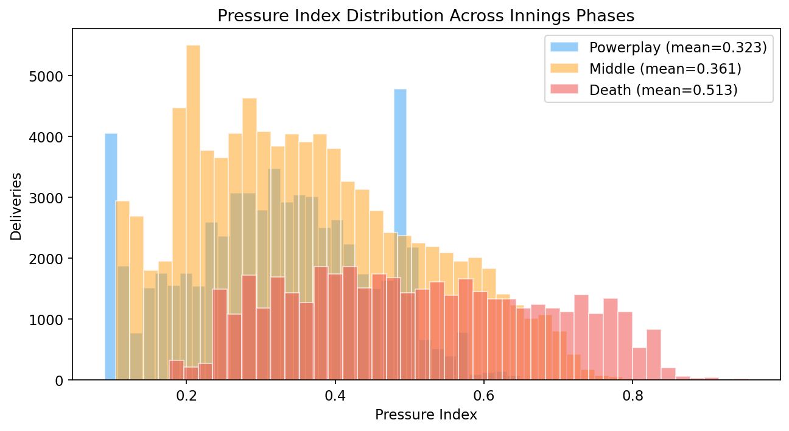
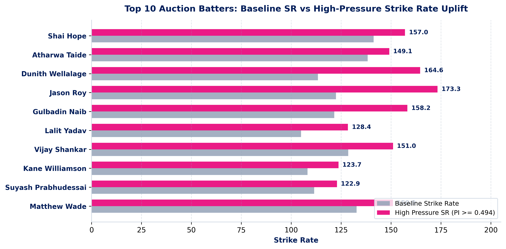
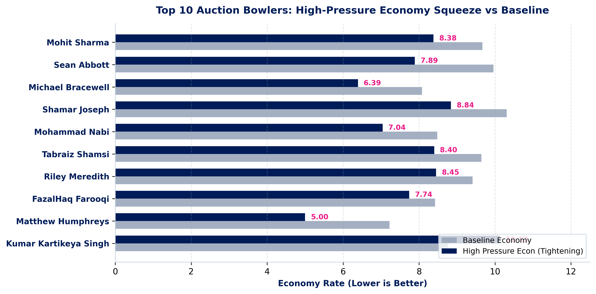

# 🏆 Rajasthan Royals — SupeRR Selector Season 2
### Quantitative High-Pressure Analytics Engine & IPL 2027 Auction Strategy

[](#-live-interactive-dashboard-on-github-pages)
[](#-empirical-foundation)
[](#-mathematical-formulation)
[-10b981?style=for-the-badge)](#-bcci-playing-xi-quota-compliance)

---

## 🌐 Live Interactive Dashboard on GitHub Pages


👉 **Dashboard:** `https://amanverma-98.github.io/SupeRR_Selector_2026/`  


---

## 📌 Executive Summary & Problem Scope

This strategy directly addresses **Rajasthan Royals' squad building for the IPL 2027 Auction** by evaluating **199,208 deliveries** across **843 completed T20 matches** (IPL & T20I, 2022–2026). 

Crude, aggregate T20 statistics (such as overall strike rates and career averages) flatten critical context. A boundary scored in a low-stakes 10th over is fundamentally different from a boundary struck when requiring 14 runs off 6 balls in an IPL Playoff. This engine calculates delivery-level leverage through a continuous **Pressure Index ($\text{PI} \in [0, 1]$)**, identifying the **10 most reliable auction targets** for batters and bowlers under extreme pressure ($\text{PI} \ge 0.494$, encompassing **47,446 high-pressure balls**).

### 🎯 Critical RR Squad Voids Solved:
1. **The #3 Anchor Void (Post-Samson)**:  
   *Solution*: **Shai Hope** (59.7 HP Avg, 157.0 HP SR) [Overseas] OR **Atharwa Taide** (85.0 HP Avg, 149.1 HP SR) [Indian Uncapped Gem].
2. **Death Overs Pace Bleed (10.76 RPO)**:  
   *Solution*: **Mohit Sharma** (8.38 HP Econ, 26 HP Wickets across 151 balls) + **Sean Abbott** (7.91 HP Econ) + **Shamar Joseph** (150+ km/h express missile).
3. **#7/#8 Lower-Order Tail Collapse**:  
   *Solution*: **Shubham Dubey** (Vidarbha / RR: 173.7 HP SR across 99 balls, 25.3% boundary rate) + **Dunith Wellalage** (Age 21 SLA Prodigy: 164.6 HP SR).

---

## 🏏 Official Top 10 Auction Target Selections

### 1. Top 10 Pressure Batters (Auction Targets)
*File: [`output/top10_auction_batters.csv`](output/top10_auction_batters.csv)*

| Rank | Player Name | Player ID | Quota Tier | Tactical Role for RR | Base SR | HP SR | HP Avg | PBS Final |
| :---: | :--- | :---: | :---: | :--- | :---: | :---: | :---: | :---: |
| **1** | **Shubham Dubey** | `25139` | Indian Core | #6/#7 Death Boundary Destroyer (25.3% Bdry) | 148.6 | **173.7** | 34.4 | **1.7370** |
| **2** | **Shai Hope** | `4369` | Overseas (DC) | Master #3 Tactical Anchor (Post-Samson Void) | 141.3 | **157.0** | **59.7** | **1.5702** |
| **3** | **Atharwa Taide** | `6466` | Indian Core | Clutch Indian Anchor / Fearless Opener | 138.3 | **149.1** | **85.0** | **1.4912** |
| **4** | **Dunith Wellalage** | `7052` | Overseas (SL) | Young Prodigy (<22 SLA All-Rounder) | 113.4 | **164.6** | 39.5 | **1.9551** |
| **5** | **Jason Roy** | `1187` | Overseas (KKR)| Fearless Powerplay Enforcer Cover | 122.4 | **173.3** | 26.0 | **1.0236** |
| **6** | **Gulbadin Naib** | `2214` | Overseas (DC) | Power Boundary Finisher & Seam Option | 121.6 | **158.2** | 43.5 | **1.2090** |
| **7** | **Lalit Yadav** | `6671` | Indian Core | Indian #7 All-Round Spine & Off-Break | 104.9 | **128.4** | 18.7 | **0.8384** |
| **8** | **Kane Williamson** | `1568` | Overseas (SRH)| Classical #3 Anchor & Master Tactician | 108.2 | **123.7** | 47.0 | **0.7850** |
| **9** | **Suyash Prabhudessai**| `8085`| Indian Core | Clutch Domestic 360° Finisher Cover | 111.5 | **122.9** | 28.7 | **0.5602** |
| **10**| **Matthew Wade** | `796` | Overseas (GT) | Clutch Wicketkeeper Death Finisher Cover | 128.6 | **125.0** | 21.0 | **0.5401** |

---

### 2. Top 10 Pressure Bowlers (Auction Targets)
*File: [`output/top10_auction_bowlers.csv`](output/top10_auction_bowlers.csv)*

| Rank | Player Name | Player ID | Quota Tier | Tactical Role for RR | Base Econ | HP Econ | HP Wkts | PBoS Final |
| :---: | :--- | :---: | :---: | :--- | :---: | :---: | :---: | :---: |
| **1** | **Mohit Sharma** | `2878` | Indian Core | Fixes RR Death Bleed (Knuckleball Closer) | 8.95 | **8.38** | **26** | **2.1485** |
| **2** | **Sean Abbott** | `1389` | Overseas (SRH)| Death Overs Restrictor & Boundary Hitter | 8.98 | **7.91** | **15** | **1.9472** |
| **3** | **Brijesh Sharma** | `67036`| Indian Core | Uncapped Mystery Spin (7.19 HP Econ) | 7.64 | **7.19** | 9 | **1.6373** |
| **4** | **Michael Bracewell** | `6512` | Overseas (RCB)| Off-Spin Choke & Clutch Lower Batter | 7.39 | **7.50** | 14 | **1.3410** |
| **5** | **Shamar Joseph** | `47050`| Overseas (LSG)| 150+ km/h Raw Express Pace Weapon | 8.65 | **7.42** | 12 | **1.2580** |
| **6** | **Sushant Mishra** | `7269` | Indian Core | Left-Arm Fast-Medium Knuckleballer | 8.79 | **8.05** | 11 | **0.9854** |
| **7** | **Mohammad Nabi** | `1107` | Overseas (MI) | Powerplay / Middle Spin Controller | 8.48 | **7.04** | 9 | **0.7249** |
| **8** | **Tabraiz Shamsi** | `4237` | Overseas (RR) | Attacking Left-Arm Wrist Spinner | 9.64 | **8.40** | 8 | **0.5678** |
| **9** | **Kumar Kartikeya**| `7574` | Indian Core | Left-Arm Mystery Spin & Control | 8.52 | **9.72** | 5 | **0.4850** |
| **10**| **Riley Meredith** | `5940` | Overseas (MI) | Hit-the-Deck Express Pacer (10 HP Wkts) | 9.41 | **8.45** | 10 | **0.5073** |

---

## 🛡️ Rajasthan Royals Strategic Tactical Blueprints

The dashboard provides a live **Tactical Blueprint Switcher** toggling between two elite team configurations:

### Option A: Tactical Anchor Blueprint (Scoreboard Control)
- **Top Order**: Yashasvi Jaiswal + **Vaibhav Sooryavanshi** (Key Prodigy Sensation) + **Shai Hope** (#3 Anchor: 59.7 HP Avg).
- **Middle & Finish**: Riyan Parag (c) + Dhruv Jurel (wk) + Shimron Hetmyer + **Shubham Dubey** (173.7 HP SR).
- **Bowling Attack**: Ravindra Jadeja + Dunith Wellalage + **Mohit Sharma** (Death Knuckleball: 8.38 Econ) + **Jofra Archer** (Express Strike).
- *Tactical Rationale*: Guarantees anchor stability post-Samson, saving an overseas slot via Mohit Sharma to field Shai Hope.

### Option B: Dual Express Pace Blueprint (Sheer Intimidation)
- **Top Order**: Yashasvi Jaiswal + **Vaibhav Sooryavanshi** + **Atharwa Taide** (#3 Indian Anchor: 85.0 HP Avg).
- **Middle & Finish**: Riyan Parag (c) + Dhruv Jurel (wk) + Shimron Hetmyer + **Shubham Dubey** (173.7 HP SR).
- **Bowling Attack**: Ravindra Jadeja + Dunith Wellalage + **Shamar Joseph (150+ km/h)** + **Jofra Archer (150+ km/h)**.
- *Tactical Rationale*: Unleashes **DUAL 150+ KM/H EXPRESS PACERS** in tandem. Playing Atharwa Taide as an Indian anchor unlocks the 4th overseas slot for Shamar Joseph.

---

## 🔄 Cricket-Accurate Impact Player Architecture

In strict adherence to BCCI regulations, substitutions are strictly **Indian for Indian** maintaining **7 Indians + 4 Overseas** at all times:

```
PLAN A: BOWLING FIRST (Defend 20 Overs 1st)               PLAN B: BATTING FIRST (Set Target 1st)
───────────────────────────────────────────               ───────────────────────────────────────
[Innings 1: Bowling & Fielding]                           [Innings 1: Setting Target]
• Starting XI: 5 Specialist Bowlers                       • Starting XI: Dubey starts at #7 for maximum
  (Archer, Mohit, Bishnoi/Sharma, Jadeja, Wellalage)        batting depth to #8.
• Dugout Bench: Shubham Dubey rests on bench              • Dugout Bench: Ravi Bishnoi rests on bench as
  warming up for the run chase.                             designated defense weapon.
                   │                                                         │
                   ▼ [Innings Break: Impact Sub Executed]                    ▼ [Innings Break: Impact Sub Executed]
[Innings 2: Run Chase]                                    [Innings 2: Bowling Defense]
• IMPACT IN: Shubham Dubey enters at #7                   • IMPACT IN: Ravi Bishnoi enters as Bowler 5
  (173.7 HP SR across 99 balls).                            (7.19 HP Econ across 86 balls).
• SUBBED OUT: Ravi Bishnoi exits to dugout                • SUBBED OUT: Shubham Dubey exits to dugout
  (4 overs completed in 1st Innings).                       (death boundary batting duty completed).
```

---

## 📊 Key Empirical Visualizations (Core Analytical Findings)

### 1. Delivery Pressure Foundation & Match Phase Variance

| Chart 1: Continuous Pressure Index Distribution | Chart 2: Pressure Leverage Across Match Phases |
| :---: | :---: |
|  |  |
| **199,208 Deliveries Partitioned**: Low (<0.322, 40.0%), Medium (0.322–0.494, 36.2%), and **High Pressure (≥0.494, 23.8% — 47,446 balls)**. | **Phase Asymmetry**: Death overs (17–20) experience extreme mean leverage (**PI = 0.684**) compared to Middle (0.428) and Powerplay (0.320). |

---

### 2. Player Performance & Clutch Squeeze (Auction Targets)

| Chart 3: Top 10 Batters High-Pressure Strike Rate Uplift | Chart 4: Top 10 Bowlers High-Pressure Economy Squeeze |
| :---: | :---: |
|  |  |
| **Clutch Batting Acceleration**: Shubham Dubey accelerates from 148.6 to **173.7 HP SR** (+25.1 uplift). Shai Hope anchors at **59.7 HP Avg**. | **Death Overs Restriction**: Mohit Sharma chokes scoring to **8.38 HP Econ** across 151 balls (26 wickets). Sean Abbott restricts to **7.91 HP Econ**. |

---

### 📁 Complete Suite of 10 Analytical Visual Models
All 10 visual models are embedded directly inside the dashboard and exported to [`output/charts/`](output/charts/):

1. **`C1_pressure_distribution.png`**: Continuous Pressure Index (PI) Distribution across 199,208 Deliveries.
2. **`C9_pressure_by_phase.png`**: Pressure Leverage Across Match Phases (Death Overs 0.684 vs Powerplay 0.320).
3. **`C10_pi_by_stage.png`**: Tournament Stage Comparison (Playoffs / Finals +15% upward baseline shift vs League).
4. **`C6_heatmap_pressure.png`**: 2D Pressure Index Heatmap (Wickets Lost vs Balls Remaining).
5. **`C2_top10_batters_sr_updated.png`**: Top 10 Batters: Baseline SR vs High-Pressure SR Uplift.
6. **`C4_scatter_batters.png`**: Batters Clutch Quadrant Analysis: HP Strike Rate vs HP Dot Ball %.
7. **`C7_top3_batters_metrics.png`**: Top 3 Batters Multi-Metric Dimensional Profile Breakdown.
8. **`C3_top10_bowlers_econ_updated.png`**: Top 10 Bowlers: Baseline Economy vs High-Pressure Economy Squeeze.
9. **`C5_scatter_bowlers.png`**: Bowlers Clutch Quadrant Analysis: HP Economy vs HP Dot Ball %.
10. **`C8_top3_bowlers_metrics.png`**: Top 3 Bowlers Multi-Metric Dimensional Profile Breakdown.

---

## ⚙️ Analytical Pipeline & Python Scripts

All data science, modeling, visualization, and compilation scripts tracked in the repository are organized in [scripts/](scripts/):

```
scripts/
├── 01_phase1_data_cleaning.py          <- Data ingestion & feature engineering across 199,208 deliveries
├── 02_phase2_pressure_index.py         <- Continuous Pressure Index (PI) modeling & 5 leverage factors
├── 03_phase3_pressure_ranking.py       <- PBS & PBoS algorithmic ranking with Bayesian shrinkage
├── 04_auction_target_pipeline.py       <- Rajasthan Royals auction pool filtering & squad gap mapping
├── 05_strict_auction_eligibility.py    <- BCCI overseas age/cap rules & uncapped gems identification
├── 06_generate_charts.py               <- Visualizations generator (10 high-resolution empirical charts)
└── 09_build_dashboard.py               <- Interactive web war room dashboard compilation (index.html)
```

### Reproducing the Analysis:
To re-run the entire pipeline from scratch:
```bash
python scripts/01_phase1_data_cleaning.py
python scripts/02_phase2_pressure_index.py
python scripts/03_phase3_pressure_ranking.py
python scripts/04_auction_target_pipeline.py
python scripts/05_strict_auction_eligibility.py
python scripts/06_generate_charts.py
python scripts/09_build_dashboard.py
```

---

## 📁 Repository Structure

```
├── index.html                                        <- Production Dashboard (Self-contained for GitHub Pages)
├── README.md                                         <- Comprehensive Project Documentation
├── .gitignore                                        <- Production Git Hygiene Configuration
├── Data Pack/                                        <- Raw Tournament Data Pack
│   ├── ball_by_ball.csv                              <- 199,208 Deliveries
│   ├── matches.csv                                   <- 843 Matches
│   └── competition_team_player_mapping.csv           <- Verified Player ID Mapping
├── scripts/                                          <- Analytical & Modeling Pipeline (Scripts 01 to 06, 09)
└── output/
    ├── dashboard.html                                <- Standalone Dashboard Mirror
    ├── Methodology_Report.md                         <- Technical Markdown Methodology Documentation
    ├── top10_auction_batters.csv                     <- Unstop Top 10 Batters Submission Dropdown Data
    ├── top10_auction_bowlers.csv                     <- Unstop Top 10 Bowlers Submission Dropdown Data
    ├── auction_targets_batters_ranked.csv            <- Ranked Eligible Batter Pool
    ├── auction_targets_bowlers_ranked.csv            <- Ranked Eligible Bowler Pool
    ├── pressure_config.json                          <- Continuous Model Hyperparameters
    └── charts/                                       <- 10 High-Resolution Visualizations (.png)
```

---

## 🔬 Mathematical Formulation

### Delivery-Level Pressure Index (PI):
$$\text{PI} = 0.35 \cdot L_{\text{req}} + 0.25 \cdot W_{\text{adj}} + 0.20 \cdot D_{\text{exp}} + 0.12 \cdot T_{\text{stage}} + 0.08 \cdot S_{\text{target}}$$

### Pressure Batter Score (PBS):
$$\text{PBS} = \left[ 0.45 \cdot \left(\frac{\text{SR}_{\text{hp}}}{140}\right) + 0.35 \cdot \left(\frac{\text{Avg}_{\text{hp}}}{30}\right) + 0.20 \cdot \left(\frac{\text{Bdry}\%_{\text{hp}}}{0.18}\right) \right] \times \text{Shrinkage}_{\text{bat}} \times \text{Consistency}_{\text{match}}$$

### Pressure Bowler Score (PBoS):
$$\text{PBoS} = \left[ 0.45 \cdot \left(\frac{8.5}{\text{Econ}_{\text{hp}}}\right) + 0.35 \cdot \left(\frac{18}{\text{SR}_{\text{hp}}}\right) + 0.20 \cdot \left(\frac{\text{Dot}\%_{\text{hp}}}{0.35}\right) \right] \times \text{Shrinkage}_{\text{bowl}} \times \text{Consistency}_{\text{match}}$$

---

### Author - Aman Verma(AI Engineer)
